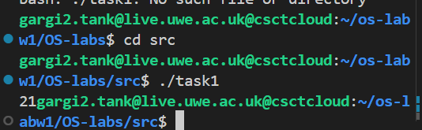
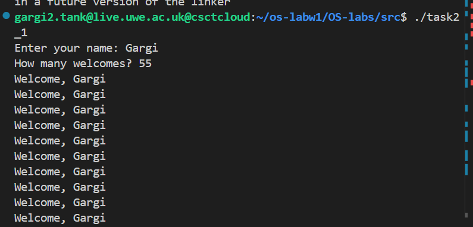
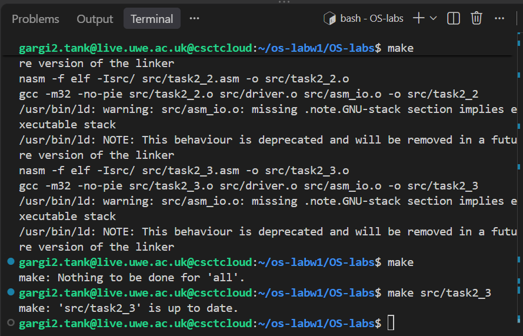

# OS-labs
# operating systems- worksheet 1

## task 1: adding two integers

This program uses x86 assembly to add two integers stored in memory and print the result.

### part 1: 

#### Implementation:

The two integers are defined in the .data segment using dd, which stores each value as a 32-bit integer. The .bss segemnt reserves memory for the result.

integer1 dd 15
integer2 dd 6

The following instructions perform the addition:

mov eax, [integer1]
add eax, [integer2]
mov [result], eax

- mov eax, [integer1]: loads the first integer into the EAX register
- add eax, [integer2]: adds the second integer to the value in EAX
- mov [result], eax: stores the calculated sum in memory

The square brackets [] indicate that the value stored at the specifies memory address is being accessed, rather than the address itself. The result is displaued using print_int, which reads the integer from EAX.

#### Testing and results:
Using the predefined values 15 and 6, the program should output 21. This demonstrates how assembly instructions can perform arithmetic operations using registers and memory.

### part 2: Adding two user-input integers

This program extends Task1.1 by allowing te user to input two integers rather than using predefined values. The program adds the integers together and displays the calculation anmd result.

#### Reading user input:
mov eax, msg1
call print_string
call read_int
mov [integer1], eax

The print_string function displays a prompt asking the user to enter a number. The read_int function reads the user's input and stores it in the EAX register. The value is then moved into the integer1 memory location. This process is repeated for the second integer.

#### Calculating the sum:
mov eax, [integer1]
add eax, [integer2]
mov [result], eax

The first integer is loaded into EAX, the second integer is added to it, and the result is stored in memory.

#### Displaying the result:
The program uses print_string to display text and print_int to display the entered integers and their sum. Unlike Task 1.1, which only displays the result, Task 1.2 shows the full calculation.

#### Testing and output:

The program was tested with the inputs 15 and 6, producing the expected result of 21. 

## task 2: loops and arrays

### part 1: welcome messgae

This program asks for the user's name and a number between 51 and 99, then prints a welcome message that many times. 

#### output

### part 2: summing an array 

This program initialises an array with the integers 1 to 100 and calculates their sum using a loop. The expected result is 5050.

#### Why does ESI start at zero?:

The ESI register is used as an index to access elements in the array. It starts at zero because the first element of an array is at index 0. After each iteration, ESI is incremented by one to access the next element, until all 100 elements have been processed.

#### Why is each array index multiplied by four?:

Each integer in the array is stored as a doubleword (resd), which occupies 4 bytes of memory. Therefore, the index must be multiplied by four to calculate the correct memory address of each element.

For example:

Index 0 → byte offset 0

Index 1 → byte offset 4

Index 2 → byte offset 8

The instruction mov [numbers + esi*4], eax uses this calculation to store each integer in the correct array position.

#### How does ECX control the loops?:

The ECX register acts as a loop counter. It is initially set to 100 because the array contains 100 elements.

The loop instruction automatically decreases ECX by one after each iteration and jumps back to the specified label if ECX is not zero.

The program uses two loops:

1. fill_array — stores the numbers 1 to 100 in the array.

2. sum_array — reads each element and adds its value to the running total stored in EBX.

Before the second loop, ECX is reset to 100 so that all elements are processed again. Once the second loop finishes, the total is moved into EAX and displayed using print_int.

Result: The program successfully calculates and outputs the sum of the integers from 1 to 100, which is 5050.

#### output

### part 3: summing a user-selected range

#### Objective:
This task extends Task2.2 by allowing the user to specify a range of integers to sum, rather than calculating the sum of all 100 elements.

#### Implementation:
The program initialises an array with values from 1 to 100 and uses read_int to obtain the starting and ending values from the user.

#### Input Validation:

Before calculating the sum, the program checks that the range is valid.

cmp eax, 1
jl invalid range

cmp ebx, 100
jg invalid_range

cmp eax, ebx
jg invalid_range

The cmp instruction compares two values, while conditional jumps such as jl (jump if less) and jg (jump if greater) determine whether the program should display an error message.

These checks ensure that the starting value is at least 1, the ending value is no greater than 100, and the starting value does not exceed the ending value.

#### Array indexing:

Because array indexing begins at zero, the starting value must be decreased by one to identify the correct array position.

mov esi, eax
dec esi

For example, entering 10 as the starting value means the program begins at array index 9.

#### Calculating the Sum:

The number of iterations is calculated using:

End - Start + 1

This insures both the starting and ending values are included in the calculation.

sum_range: 
    add ebx, [numbers + esi*4]
    inc esi
    loop sum_range

- EBX: stores the running total
- ESI: tracks the current array index
- ECX: controls the number of iterations through the loop instruction
- ESI*4: calculates the memory offset because each integer occupies 4 bytes 

After the loop finishes, the total is moved into EAX and displayed using print_int.

#### Testing and results:

The following test cases can be used to verify the program:

| Starting Value | Ending Value | Expected Output |
|---|---|---|
| 10 | 20 | 165 |
| 1 | 100 | 5050 |
| 5 | 5 | 5 |
| 30 | 20 | Error message |
| 0 | 20 | Error message |
| 10 | 101 | Error message |

These tests check both the accuracy of the sum and the effectiveness of the input validation.

Valid Range: 

Invalid Range:

## task 3: Makefile 

### Build verification:

The Makefile was tested by running make, which successfully built all 5 executable programs from Task 1 and 2. 

After correcting the target paths to match the location of the generated executables, running make again confirmed that Make could recognise unchanged files and avoid unnecessary rebuilding.

The make clean command was used to remove generated object files and executables, allowing the programs to be rebuilt from scratch.

The linker displayed warnings relating to the missing .note.GNU-stack section in asm_io.o. These did not prevent successful compilation and linking.

### make command output:

